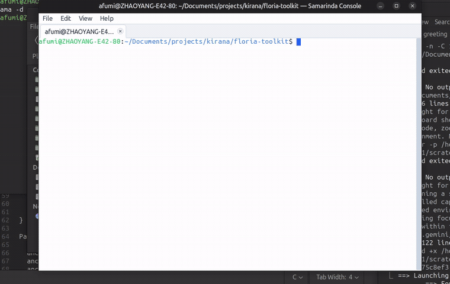
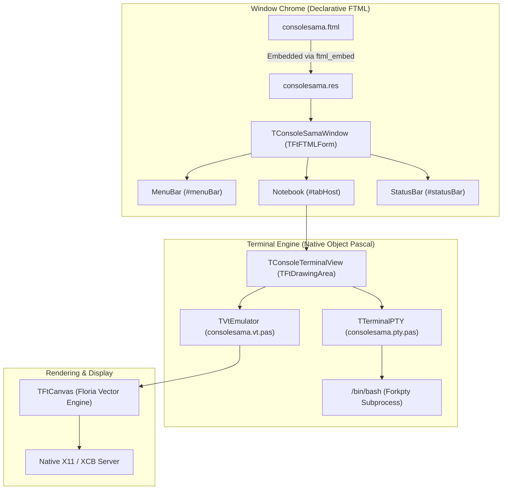

# Consolesama

[](https://opensource.org/licenses/MPL-2.0)
[-orange.svg)](https://github.com/floria-toolkit)
[](https://github.com/pasbuild)

**Consolesama** (Samarinda Console) is a fast, lightweight, and modern terminal emulator for Linux, built with [Floria Toolkit (Ft)](https://github.com/floria-toolkit), [ftpas](https://github.com/floria-toolkit/ftpas), and Free Pascal.

Combining the declarative elegance of **FTML (Floria Toolkit Markup Language)** for window chrome with high-performance native Pascal terminal rendering, Consolesama provides a clean desktop experience inspired by classic GNOME and MATE Terminal.

---

## Demo



---

## Features

- **Hybrid Declarative & Native Architecture**:
  - Window chrome (menu bar, tabs notebook, status bar, and anchor layouts) is declaratively described in [`consolesama.ftml`](src/main/ftml/consolesama.ftml) and compiled directly into executable resources via `ftml_embed`.
  - Terminal panes run as high-performance native `TFtDrawingArea` canvases with 2D vector graphics.
- **Robust VT100 / VT220 / xterm Emulator Core**:
  - Complete ANSI & SGR formatting: bold, dim, italic, underline, reverse video, 16 ANSI colors, 256-color palette, and 24-bit TrueColor RGB.
  - Alternate screen buffer support for full-screen CLI apps (`vim`, `htop`, `less`, `nano`).
  - Terminal buffer reflow on window resize with height preservation and prompt stabilization (no cursor drift or prompt duplication).
  - Bracketed paste mode and OSC title reporting.
- **Crisp Monospace Typography**:
  - Monospace font rendering (defaults to `Ubuntu Mono 13`) with HarfBuzz shaping and FreeType/FontConfig integration.
  - Sub-pixel anti-aliased character drawing powered by the Floria 2D vector canvas.
- **Interactive Multi-Tab Management**:
  - Open and close tabs with shortcuts (`Ctrl+Shift+T` / `Ctrl+Shift+W`) or UI close buttons.
  - Tab title maximum width constraints (`maxTabWidth: 220;`) and automatic text ellipsis truncation (`...`) for long titles (e.g. deep directory paths).
  - Full title tooltips on tab hover.
  - Horizontal tab strip scrolling with `<` / `>` chevron navigation buttons and mouse wheel support when tabs exceed container width.
- **Desktop Menus & Keyboard Accelerators**:
  - Complete desktop menu bar with accelerators: Copy/Paste, Select All, Font Zoom, Dark Mode toggle, and navigation.
  - Native clipboard integration via X11 selection and ICCCM/EWMH protocols.
- **Status Bar & Developer Aids**:
  - Optional bottom status bar displaying active terminal dimensions, PID, and debug statistics (`--debug` or `-d`).

---

## Architecture



---

## Keyboard Shortcuts

| Shortcut | Action |
| :--- | :--- |
| `Ctrl+Shift+T` | Open a new terminal tab |
| `Ctrl+Shift+W` | Close current terminal tab |
| `Ctrl+Shift+N` | Open a new terminal window |
| `Ctrl+Shift+C` | Copy selected text to clipboard |
| `Ctrl+Shift+V` | Paste text from clipboard |
| `Ctrl+Shift+A` | Select all terminal output |
| `Ctrl+Plus` (`Ctrl+=`) | Zoom in (increase font size) |
| `Ctrl+Minus` | Zoom out (decrease font size) |
| `Ctrl+0` | Reset font size to default |
| `Ctrl+Shift+D` | Toggle dark / light theme mode |
| `Shift+PageUp` | Scroll up terminal history |
| `Shift+PageDown` | Scroll down terminal history |
| `Ctrl+Q` | Quit application |

---

## Requirements

- **Linux Operating System** with native **X11 / XCB** display server.
- **Free Pascal Compiler (FPC)** 3.2.0 or newer.
- **Pasbuild** project and build manager.
- **Floria Toolkit Core Libraries**:
  - `florialib:0.0.1-SNAPSHOT`
  - `ftpas:0.0.1-SNAPSHOT`

---

## Building & Testing

Consolesama is managed with `project.xml` and Pasbuild. A convenient `./build.sh` script is provided for common workflows:

### 1. Compile Consolesama
```bash
./build.sh compile
```
The executable binary is generated at `target/consolesama`.

### 2. Run Tests
Consolesama includes a comprehensive test suite (42 unit tests) covering VT emulation, PTY lifecycle, terminal resize reflow, key translation, and window management:
```bash
./build.sh test
```

### 3. Launch Consolesama
```bash
./build.sh run
```

To run with the developer status bar enabled:
```bash
./build.sh run --debug
```

### 4. Regenerate FTML Resources
If you modify `src/main/ftml/consolesama.ftml`:
```bash
./build.sh ftml
```

---

## Project Structure

```
consolesama/
├── assets/
│   └── consolesama.gif         # Showcase animation
├── src/
│   ├── main/
│   │   ├── ftml/
│   │   │   └── consolesama.ftml # Declarative UI layout & menu definitions
│   │   └── pascal/
│   │       ├── consolesama.pas          # Application entry point
│   │       ├── consolesama.window.pas   # Main form & UI event bindings
│   │       ├── consolesama.terminal.pas # Custom drawing area & terminal canvas
│   │       ├── consolesama.vt.pas       # VT100/VT220/xterm emulator state machine
│   │       ├── consolesama.pty.pas      # POSIX pseudoterminal process management
│   │       ├── consolesama.keys.pas     # X11 keysym to ANSI sequence mapper
│   │       └── consolesama.res          # Compiled binary FTML resource
│   └── test/
│       └── pascal/                      # Unit test suites (42 tests)
├── build.sh                             # Build, test, and run automation
├── project.xml                          # Pasbuild project descriptor
└── README.md                            # Documentation
```

---

## License

Consolesama is released under the [Mozilla Public License 2.0 (MPL-2.0)](LICENSE).  
Copyright (c) 2026 Dio Affriza.
